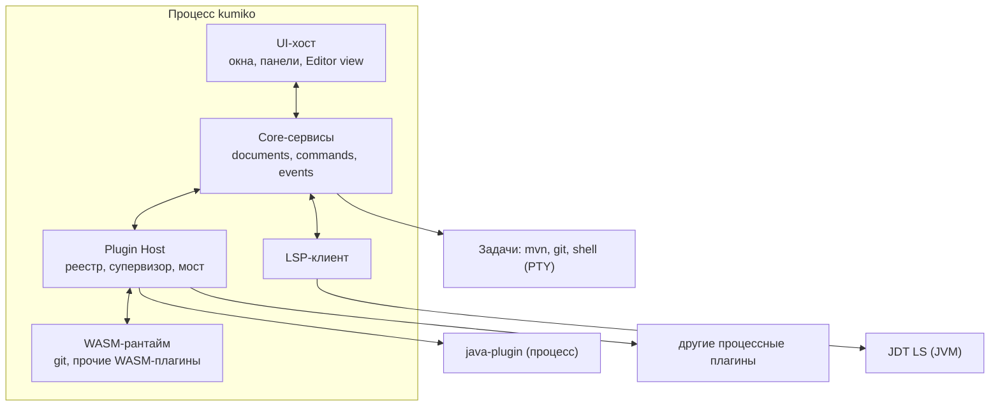
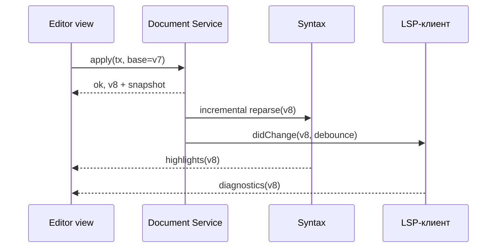
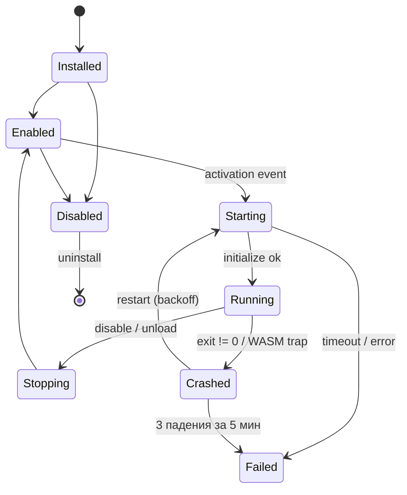
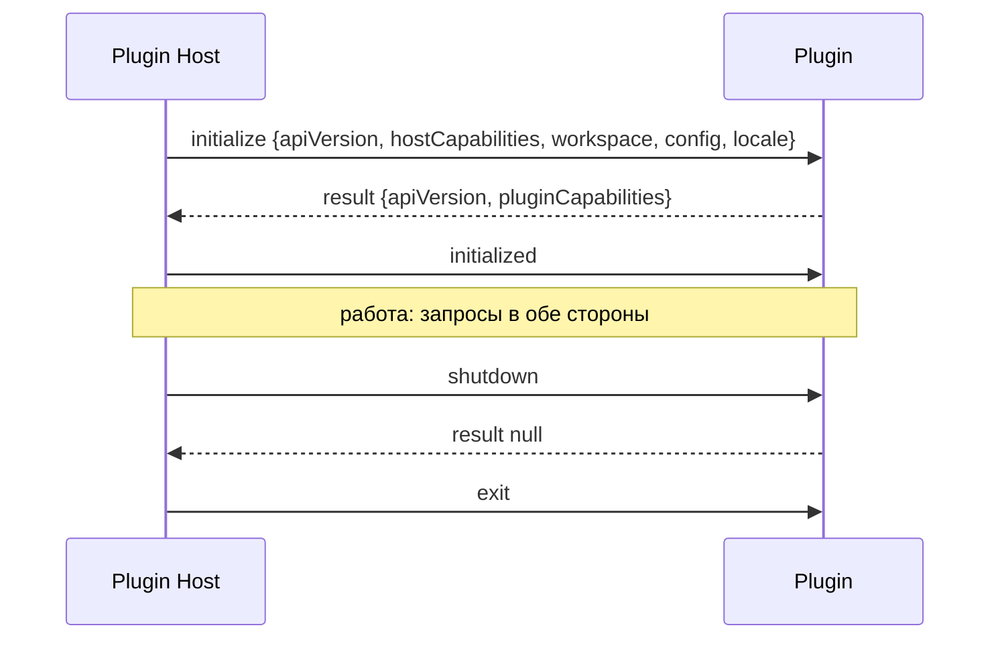

# Kumiko — модульная native IDE

**Техническое задание v1.0 (единая редакция)**
Дата: 23.09.2026 · Статус: черновик для утверждения владельцем проекта

Документ полностью заменяет ТЗ v0.1 и «Архитектура фундамента и ТЗ на реализацию v0.2». Он самодостаточен: для работы агента-исполнителя другие версии не нужны.

## Содержание

0. О названии и документе
1. Цель проекта и принципы
2. Критерий успеха
3. Критерии готовности MVP
4. Что НЕ делать в MVP
5. Ключевые архитектурные решения
6. Проблемы исходной концепции и решения
7. Прецеденты и уроки
8. Модель процессов и уровни компонентов
9. Технологический стек
10. Структура репозитория и границы модулей
11. Core-сервисы и их API
12. Модель документов и Editor
13. Плагинная система
14. Межплагинные интерфейсы
15. Kits — сборка IDE как конструктора
16. Протокол плагинов (Kumiko Plugin Protocol v1)
17. SDK и языки написания плагинов
18. Языки: Tree-sitter, LSP, Java-плагин
19. Процессы, задачи, Terminal, Git, Debugger
20. UI-слой
21. Ресурсы (L3): грамматики, темы, иконки, локализация
22. Конфигурация, keymap, пути хранения
23. Нефункциональные требования и бюджеты
24. Лицензии и риски
25. ADR
26. Открытые вопросы
27. Дорожная карта после MVP
28. План реализации для агента
29. Тесты модульности
30. Правила для агента-исполнителя
31. Логотип и айдентика

---

## 0. О названии и документе

**Kumiko** (組子) — японская столярная техника: решётчатые узоры собираются из тонких деревянных реек без гвоздей и клея. Каждая деталь держится только за счёт точности соединений. Это прямая метафора проекта: независимые модули держатся вместе только стабильными контрактами (API), и любую деталь можно вынуть и заменить.

Идентификаторы в коде:

| Что | Значение |
|---|---|
| Бинарник / CLI | `kumiko` |
| Префикс крейтов | `kumiko-*` |
| ID встроенных плагинов | `kumiko.<name>` (например, `kumiko.java`) |
| Каталог настроек проекта | `<workspace>/.kumiko/` |
| Протокол плагинов | Kumiko Plugin Protocol, KPP |
| WIT-пакет | `kumiko:plugin@1.0.0` |

TODO(open-question-1): до первого публичного релиза проверить свободность имени на crates.io, GitHub (организация), доменах и в реестрах товарных знаков.

---

## 1. Цель проекта и принципы

Создать open-source модульную native IDE, **лёгкую, быструю и собираемую как конструктор**: пользователь собирает рабочую среду из независимых компонентов, а плагины можно писать на разных языках.

Ключевые свойства:

1. Native-first архитектура, без Electron/webview в ядре и UI.
2. Основной язык ядра — Rust. C/C++ допускаются через FFI только для существующих высокопроизводительных библиотек и системных интеграций, где это существенно упрощает реализацию.
3. Java — первый полноценно поддерживаемый язык.
4. Новые языки добавляются без изменения ядра.
5. Компоненты максимально заменяемы: пользователь устанавливает, удаляет, отключает и заменяет их.
6. Плагины изолированы от ядра стабильным версионированным API.
7. Плагины пишутся на разных языках: через WebAssembly-компоненты (Rust, JS/TS, Python, Go, C/C++ и др.) и через отдельные процессы (любой язык).
8. Лёгкость измеряется, а не декларируется: бюджеты памяти, CPU и задержек (раздел 23).
9. Первая платформа — Linux (x86_64, aarch64); Windows и macOS — в будущем, без переделки архитектуры.

Принципы:

- «Сначала рабочее ядро + Java LSP + editor. Потом всё остальное.»
- Проект не оценивается по количеству функций. Оценивается заменяемость компонентов (раздел 2).
- Rust сам по себе не делает IDE быстрее: тяжёлая аналитика Java выполняется JDT LS. Ценность Kumiko — отзывчивость UI, малый расход ресурсов самой IDE и модульность.
- Протоколы заимствуются (LSP, DAP, JSON-RPC, WASM Component Model), свои изобретаются только там, где готовых нет.

---

## 2. Критерий успеха

Главный вопрос: **можно ли удалить или заменить компонент без изменения Core?**

| Действие | Ожидаемый результат |
|---|---|
| Удалили Java-плагин | IDE работает, `.java` открывается как текст |
| Удалили Git-плагин | IDE работает, нет только git-функций |
| Заменили Editor | Остальные компоненты работают (в MVP — замена на этапе сборки) |
| Упал Java-плагин или JDT LS | IDE работает, правки не потеряны, плагин перезапущен |
| Применили другой kit | Состав IDE изменился без пересборки |
| Установили плагин, написанный не на Rust | Он работает через тот же API, что и встроенные |

Если всё это выполняется и проверяется автоматически в CI (раздел 29), архитектура действительно модульная.

---

## 3. Критерии готовности MVP

Версия 0.1 готова, если пользователь может:

1. Запустить IDE.
2. Открыть существующий Java Maven project.
3. Увидеть дерево проекта.
4. Открыть Java-файл.
5. Редактировать его.
6. Получить syntax highlighting.
7. Получить autocomplete через LSP.
8. Получить diagnostics.
9. Перейти к definition.
10. Выполнить поиск: полнотекстовый по проекту и быстрый переход к файлу по имени (Quick Open).
11. Запустить Maven test.
12. Открыть встроенный terminal.
13. Выполнить Git status.
14. Установить и удалить plugin.
15. Завершить (в том числе `kill -9`) Java-плагин без падения Core.
16. Установить WASM-плагин, написанный не на Rust, и вызвать его команду.
17. Применить kit (например, переключиться между `minimal` и `java`) без пересборки IDE.
18. Применить quick fix из LSP (например, organize imports или добавление импорта в Java).

---

## 4. Что НЕ делать в MVP

Запрещается распыляться на:

- полноценный debugger (фиксируется только решение: DAP);
- собственный Java compiler или type system;
- собственную реализацию Git;
- собственный database engine;
- собственный terminal emulator (используется библиотека);
- собственную LLM;
- поддержку 20 языков;
- marketplace и онлайн-registry плагинов (установка — из каталога или архива; kits — из файла);
- синхронизацию настроек;
- cloud IDE;
- webview и произвольный рендер из плагинов;
- sandbox для процессных плагинов (для WASM-плагинов изоляция есть по построению);
- общие рантайм-хосты для Node/JVM/Python-плагинов (раздел 17, после MVP);
- платформы, кроме Linux; удалённые ФС; multi-root workspace в UI (в модели он есть).

Ничего из этого не реализуется даже частично без явного решения владельца.

---

## 5. Ключевые архитектурные решения

1. **Три уровня кода + данные.** In-process сервисы ядра (L0), in-process UI-компоненты включая редактор (L1), расширения (L2), данные без кода (L3). Изоляция процессом — только там, где она не ломает задержку ввода.
2. **Два вида расширений L2.** WASM-компоненты в процессе ядра (лёгкие, изолированные песочницей, на любом языке с поддержкой Component Model) — вид по умолчанию. Отдельные процессы — для тяжёлых задач, сетевых загрузок и языков без WASM-тулчейна.
3. **Документ принадлежит ядру, а не редактору.** Core владеет буферами и версиями; Editor — view/controller.
4. **Протоколы заимствуются.** Language API повторяет семантику LSP 3.17, Debugger API — DAP. Свой протокол только для плагинов (KPP), и он один для обоих видов плагинов.
5. **Вклады плагинов декларативны.** Команды, меню, keybindings, настройки, языки, панели, предоставляемые интерфейсы описываются в манифесте. Ядро показывает их без запуска плагина; плагин активируется лениво.
6. **UI плагинов декларативный.** Плагин отдаёт модели (дерево, список, форма, статус, декорации), рисует только UI-хост.
7. **IPC для процессных плагинов:** JSON-RPC 2.0 в бинарных фреймах поверх stdio, с бинарными потоками для PTY и больших данных. Для WASM — WIT-интерфейс с теми же методами и JSON-payload.
8. **Плагины общаются друг с другом через версионированные интерфейсы** (`provides`/`consumes`), маршрутизируемые ядром. Прямых соединений между плагинами нет.
9. **Kits** — декларативные наборы плагинов, ресурсов и настроек; основа «конструктора».
10. **Ядро без UI запускается headless.** Это основа интеграционных тестов и проверки модульности.
11. **MVP проверяется измерениями.** Бюджеты — в разделе 23.

---

## 6. Проблемы исходной концепции и решения

| # | Проблема | Почему это проблема | Решение |
|---|---|---|---|
| P1 | «Все плагины в отдельных процессах» vs «Editor — заменяемый плагин» | Клавиша через IPC и обратно добавляет задержку и джиттер; подсветка на каждое изменение через IPC нереалистична | Редактор и UI — in-process L1. Изоляция — только для L2 |
| P2 | TextBuffer внутри Editor | При замене/падении редактора теряются правки; LSP и плагины не видят несохранённый текст | Document Service в ядре (раздел 12) |
| P3 | «UI API» для плагинов вне процесса | Нативные виджеты нельзя передать через IPC | Декларативные модели UI (раздел 20) |
| P4 | У Rust нет стабильного ABI | Плагины как `.so` ломаются при смене компилятора | WASM Component Model (стабильный ABI по построению) и процессы. C ABI — только для L1 в будущем |
| P5 | LSP Client в Core и «Core не знает о языках» | Непонятно, кто запускает JDT LS и выбирает JDK | Generic LSP-клиент в ядре; языковой плагин описывает запуск сервера и перехватывает специфичные методы |
| P6 | enabled/disabled у команд | Нельзя опрашивать плагины при каждом рендере меню | Context keys + when-выражения в ядре |
| P7 | Shortcut внутри команды | Конфликты и пользовательские раскладки неразрешимы | Keymap — отдельный слой |
| P8 | Event Bus как единственный механизм | Скрытые зависимости, шторм событий (Maven меняет тысячи файлов) | События + команды + сервисы + интерфейсы; фильтры, coalescing, debounce |
| P9 | Terminal плагином и «не писать эмулятор» | VT-эмуляция — это рендеринг; байты PTY через JSON неэффективны | PTY — сервис ядра, эмулятор — библиотека в UI, бинарные потоки |
| P10 | Project System с моделью зависимостей | JDT LS уже импортирует Maven/Gradle | Ядро делает детекцию и корни; модель — от build-плагина |
| P11 | «Ограничение доступа» плагинов | Процесс с правами пользователя не ограничен | WASM: permissions enforced; процессы: декларативно, sandbox позже |
| P12 | Hot reload с восстановлением состояния | Требует сериализации состояния | `state/save`, `state/restore` в протоколе с v1 |
| P13 | Позиции в тексте | LSP — UTF-16, Rust — UTF-8, Tree-sitter — байты | Внутри UTF-8; конвертация только на границе LSP |
| P14 | «Лёгкая IDE» при Java | JDT LS — JVM на 0,5–2 ГБ | Метрики IDE и внешних серверов разделены |
| P15 | UI и Core, возможно, разные процессы | Опыт xi-editor: асинхронное разделение резко усложнило систему | UI в процессе ядра, связь типизированными каналами |
| P16 | «Можно ли удалить компонент» не проверяется | Модульность деградирует незаметно | Headless + CI-тесты модульности + проверка графа крейтов |
| P17 | Процесс на каждый плагин противоречит лёгкости | Node-плагин ≈ 40 МБ, JVM ≈ 100+ МБ; десяток плагинов съедает бюджет | WASM-плагины in-process по умолчанию; процессы — по необходимости; общие рантайм-хосты после MVP |
| P18 | Мультиязычность плагинов заявлена, но SDK только Rust | Цель не проверяется | WIT-пакет — языконезависимый контракт; эталонный плагин не на Rust — критерий MVP 16 |
| P19 | «Конструктор» недостижим, если L1 меняется только сборкой | Пользователь не может собрать свою IDE | Kits (раздел 15) для L2/L3 в рантайме; профили сборки для L1 |
| P20 | Плагины взаимодействуют только командами и событиями | Нет типизированного API между плагинами (AI ↔ Git) | `provides`/`consumes` с semver (раздел 14) |
| P21 | Доставка событий at-most-once | Плагин, потерявший `document.changed`, работает с рассинхронизированным текстом | Два класса событий; события состояния без потерь, с версиями и resync (раздел 11) |
| P22 | LSP MVP без codeAction и signatureHelp | Без quick fix и импортов Java неудобна | Добавлены codeAction, applyEdit, signatureHelp, inlay hints |
| P23 | Quick Open без индекса имён файлов | Search описан только как полнотекстовый | FileIndex с fuzzy-матчингом (раздел 11) |
| P24 | Нет формата тем, локализации, доступности | Токены тем есть, а темы нет; UI только на одном языке; скринридеры не работают | Сервис Resources, l10n в манифестах, AccessKit в критериях UI-спайка |
| P25 | ТЗ v0.2 ссылалось на разделы v0.1 | Агент без v0.1 не знает критериев приёмки | Единый самодостаточный документ |

---

## 7. Прецеденты и уроки

Изучить до закрытия Phase 0 (результат — заметка `docs/research/prior-art.md`).

| Проект | Что взять | Что изучить / чего избегать |
|---|---|---|
| VS Code | Декларативные contribution points, activation events, when-clauses, LSP/DAP, extension host | Вес Node-хоста, webview как неограниченный API |
| Zed | Rust, собственный GPU-тулкит (GPUI), расширения как WASM-компоненты с WIT | Какие возможности их WIT-API не даёт авторам расширений и почему |
| Lapce | Rust IDE с тулкитом Floem и WASI-плагинами — ближайший аналог Kumiko | Какие ограничения плагинного API мешали экосистеме; как решены LSP и терминал |
| Helix | Структура Tree-sitter queries (highlights, textobjects), runtime-каталог грамматик | Пример того, как трудно добавлять расширяемость поздно |
| xi-editor | CRDT/rope, разделение frontend/core | Асинхронное разделение UI и ядра на процессы резко усложнило систему (P15) |
| IntelliJ IDEA | Эргономика Java-сценариев, run configurations | Не копировать: собственный анализатор и монолитная модель проекта — вне цели |

---

## 8. Модель процессов и уровни компонентов

Один главный процесс (ядро + UI + WASM-плагины) и дерево дочерних процессов, которыми ядро управляет как супервизор.



JDT LS и пользовательские процессы (Maven, git, shell) запускает ядро, а не плагин: так их можно корректно завершить даже после падения плагина.

| Уровень | Где живёт | Язык | Как заменяется | Примеры |
|---|---|---|---|---|
| L0 Core-сервисы | Главный процесс | Rust | Не заменяются пользователем | Documents, Commands, Events, Config, FS, Plugin Host, Process, LSP-клиент |
| L1 UI-компоненты | Главный процесс, UI-поток | Rust | На этапе сборки (альтернативный крейт, реализующий trait); в будущем C ABI / WASM | Workbench, Editor view, File Explorer, Terminal view |
| L2w WASM-расширения | Главный процесс, песочница wasmtime, пул потоков | Любой с поддержкой WASM Component Model | Установка/удаление/отключение в рантайме | git, terminal (логика), форматтеры, линтеры, темы с логикой |
| L2p Процессные расширения | Отдельный процесс на плагин | Любой (MVP — Rust SDK) | Установка/удаление/отключение в рантайме | java, будущие database, ai |
| L3 Данные | Файлы, без кода | — | Установка/удаление в рантайме | Грамматики, темы, иконки, keymaps, сниппеты, локализации, kits |
| Внешние серверы | Отдельные процессы | Любой | Через конфигурацию плагина | JDT LS, rust-analyzer, clangd, DAP-адаптеры |

Правила:

- L0 не зависит ни от L1, ни от L2. L1 получает всё через фасад `CoreApi`, L2 — через KPP.
- L1 никогда не содержит логики языков, VCS или сборки.
- Падение L2 (trap WASM, выход процесса) или внешнего сервера не завершает главный процесс. Паника в L1 перехватывается на границе компонента (`catch_unwind`) там, где возможно; иначе считается багом ядра.
- WASM-плагины никогда не исполняются в UI-потоке.
- Замена Editor в MVP выполняется на уровне сборки: второй крейт-реализация `EditorView` подключается без изменений в L0 и L2.

Выбор вида плагина:

| Нужно плагину | Вид |
|---|---|
| Команды, UI-модели, работа с документами и файлами workspace, запуск процессов через ядро | WASM (по умолчанию) |
| Прямой сетевой доступ, файлы вне workspace, долгие CPU-задачи, большие зависимости | Процесс |
| Язык без WASM-тулчейна | Процесс |

---

## 9. Технологический стек

| Область | Выбор | Причина |
|---|---|---|
| Язык | Rust stable, MSRV фиксируется в `rust-toolchain.toml` | Требование проекта |
| Асинхронность | Tokio (multi-thread), rayon для CPU-задач | Стандарт экосистемы |
| Сериализация | serde, serde_json, toml | Протокол, конфиги |
| Схемы | schemars | JSON Schema из типов протокола |
| Логирование | tracing, tracing-subscriber | Спаны для метрик |
| Ошибки | thiserror в библиотеках, anyhow в `app/` и тестах | |
| Текст | ropey | Rope-буфер |
| Синтаксис | tree-sitter, libloading | Грамматики |
| WASM | wasmtime (Component Model), wit-bindgen | Плагины L2w |
| Рендер текста | cosmic-text | Шейпинг, fallback-шрифты, bidi |
| Терминал | alacritty_terminal, portable-pty | VT-эмуляция, PTY |
| ФС | notify, ignore, globset | Watcher, `.gitignore` |
| Поиск | grep-searcher/grep-regex, nucleo | Полнотекстовый и fuzzy-поиск |
| LSP-типы | lsp-types | |
| Пути | directories | XDG и будущий порт |
| UI-тулкит | По итогам спайка (раздел 20) | |
| CI | cargo fmt, clippy `-D warnings`, cargo test, cargo-deny | |

C/C++ — только через FFI в отдельных `*-sys` крейтах с `// SAFETY:` комментариями. Не использовать C++ без необходимости.

---

## 10. Структура репозитория и границы модулей

Один Cargo workspace; граница модуля = граница крейта; допустимые зависимости проверяются в CI.

```text
kumiko/
├── Cargo.toml                    # workspace, общие версии зависимостей
├── rust-toolchain.toml
├── crates/
│   ├── kumiko-types/             # Uri, DocumentId, Position, Range, TextEdit, ids, ошибки, пути
│   ├── kumiko-protocol/          # сообщения KPP (serde), каталог методов, версии, capabilities
│   ├── kumiko-ipc/               # фрейминг, транспорт, RPC-пир, стримы, отмена
│   ├── kumiko-core/              # фасад CoreApi + композиция сервисов
│   ├── kumiko-events/
│   ├── kumiko-commands/          # реестр команд, context keys, when-выражения
│   ├── kumiko-config/            # слои настроек, схемы, keymap
│   ├── kumiko-fs/                # VFS, watcher, ignore-правила
│   ├── kumiko-documents/         # rope, версии, транзакции, undo
│   ├── kumiko-project/           # детекция проектов, workspace folders
│   ├── kumiko-process/           # процессы, PTY, задачи
│   ├── kumiko-search/            # полнотекстовый поиск + FileIndex (Quick Open)
│   ├── kumiko-syntax/            # грамматики Tree-sitter, highlight, folding
│   ├── kumiko-lsp/               # generic LSP-клиент
│   ├── kumiko-resources/         # реестр L3: грамматики, темы, иконки, l10n, keymaps, kits
│   ├── kumiko-plugin-host/       # манифесты, реестр, супервизор, интерфейсы, kits, мост
│   ├── kumiko-wasm-host/         # wasmtime, привязки WIT ↔ KPP, лимиты
│   ├── kumiko-ui/                # UI-хост: workbench, layout, панели, palette, темы
│   ├── kumiko-editor-view/       # реализация EditorView
│   ├── kumiko-terminal-view/     # VT-эмулятор + рендер
│   └── kumiko-headless/          # драйвер для тестов без UI
├── app/kumiko/                   # бинарник: composition root, CLI
├── sdk/
│   ├── wit/kumiko-plugin/        # WIT-пакет kumiko:plugin@1.0.0
│   ├── rust/kumiko-plugin-sdk/   # SDK на Rust: features "process" и "wasm"
│   └── examples/                 # эталонные плагины, в т.ч. не на Rust
├── plugins/
│   ├── java/                     # L2p
│   ├── git/                      # L2w
│   └── terminal/                 # L2w
├── resources/
│   ├── grammars/java/            # грамматика + queries
│   ├── themes/                   # темы по умолчанию (светлая, тёмная)
│   ├── icons/                    # иконочная тема по умолчанию
│   ├── keymaps/default.toml
│   └── l10n/                     # en, ru
├── kits/
│   ├── minimal.kit.toml
│   └── java.kit.toml
├── docs/ adr/ protocol/ research/ sdk/
├── tests/                        # интеграционные (headless), modularity/
└── benchmarks/
```

Граф допустимых зависимостей (стрелка = «может зависеть от»):

| Крейт | Может зависеть от | Не может зависеть от |
|---|---|---|
| kumiko-types | только внешних (serde, directories) | всего внутреннего |
| kumiko-protocol | kumiko-types | сервисов, UI, ipc-рантайма |
| kumiko-ipc | kumiko-protocol, kumiko-types | сервисов, UI |
| Сервисы ядра (events … plugin-host, wasm-host, resources) | types, protocol, ipc; друг от друга только через трейты в kumiko-core | UI-крейтов, плагинов |
| kumiko-core | сервисов ядра | UI-крейтов, плагинов |
| UI-крейты | kumiko-core (только фасад CoreApi), kumiko-types | конкретных сервисов, плагинов |
| kumiko-plugin-sdk | kumiko-protocol, kumiko-ipc, kumiko-types, wit-bindgen | kumiko-core, сервисов, UI |
| Плагины | kumiko-plugin-sdk | всего остального внутреннего |
| app/kumiko | всех L0/L1 | плагинов (ставятся отдельными артефактами) |

Контроль: тест `tests/architecture.rs` читает `cargo metadata` и падает при нарушении таблицы. Упоминание `java`, `maven`, `gradle`, `git` в коде L0/L1 проверяется grep-правилом в CI (кроме тестов и комментариев).

---

## 11. Core-сервисы и их API

Ядро — 14 сервисов за одним фасадом `CoreApi`; у каждого есть Rust-трейт для L1 и зеркальное пространство методов в KPP для L2.

Общие соглашения:

- Все сервисы асинхронные. UI-поток не блокируется вызовами сервисов; ответы приходят сообщениями.
- Идентификаторы: `Uri` (схемы `file:`, `untitled:`, `jdt:`, `git:` и др. — схема не интерпретируется ядром), `DocumentId`, `PluginId` (reverse-DNS, `kumiko.java`), `CommandId` (`namespace.action`), `InterfaceId` (`kumiko.git.repository`).
- Ошибки KPP имеют код из фиксированного перечня (раздел 16).
- Регистрации возвращают `Disposable`; при выгрузке плагина ядро освобождает всё, что он зарегистрировал.

| Сервис | Ответственность | Ключевые операции | Кто использует |
|---|---|---|---|
| Events | Типизированные уведомления, фильтры, coalescing, классы доставки | `subscribe(filter)`, `publish(event)` | Все |
| Commands | Реестр команд, context keys, when-выражения | `register`, `execute(id, args)`, `set_context`, `list` | UI, плагины |
| Config | Слои настроек, схемы плагинов, keymap | `get(key, scope)`, `update`, `on_change(section)` | Все |
| FileSystem | VFS поверх провайдеров (`file:` в MVP), watcher | `read`, `write`, `stat`, `create`, `delete`, `rename`, `copy`, `read_dir`, `watch(glob)` | Documents, Project, плагины |
| Documents | Буферы, версии, транзакции, undo/redo, save/revert, dirty-state | `open`, `apply(edit, base_version)`, `save`, `snapshot`, `close` | Editor, LSP, плагины |
| Project | Workspace folders, детекция типа, исключения | `open_folder`, `folders`, `detect`, `set_model(provider)` | UI, плагины |
| Process | Процессы и PTY, потоки вывода, завершение дерева | `spawn`, `spawn_pty`, `write`, `resize`, `kill`, `wait` | Terminal, задачи, LSP, плагины |
| Tasks | Провайдеры задач (build/test/run), запуск через Process | `provide`, `run`, `cancel` | UI, плагины |
| Search | Полнотекстовый поиск с учётом `.gitignore`; FileIndex для Quick Open (fuzzy, nucleo) | `search(query) → stream`, `find_files(pattern) → stream` | UI |
| Syntax | Грамматики L3, парсинг, highlight, folding, структурное выделение | `language_for(uri)`, `parse`, `highlights(range)`, `folds` | Editor |
| Language (LSP) | Generic клиент, маршрутизация по языку, мерж результатов | completion, definition, references, hover, rename, codeAction, diagnostics… | Editor, UI |
| Plugin Host | Манифесты, установка, состояния, супервизия, интерфейсы, kits, мост KPP (процессы и WASM) | `install`, `uninstall`, `enable`, `disable`, `restart`, `list`, `kit_apply` | UI, CLI |
| Resources | Реестр L3: грамматики, темы, иконки, keymaps, сниппеты, локализации | `list(kind)`, `get(id)`, `localize(key, locale)` | UI, Syntax, Config |
| Log/Telemetry | tracing, метрики производительности (только локально) | `span`, `metric` | Все |

### События

Имена стабильны, payload версионируется: `workspace.folderAdded`, `workspace.folderRemoved`, `document.opened`, `document.changed` (версия + список правок), `document.saved`, `document.closed`, `fs.changed` (пакет, уже после coalescing), `plugin.stateChanged`, `task.started`, `task.finished`, `config.changed`, `interface.availabilityChanged`.

Два класса доставки:

| Класс | События | Гарантия |
|---|---|---|
| A — состояние | `document.*`, `config.changed`, `plugin.stateChanged`, `task.*`, `interface.*`, `workspace.*` | Без потерь, порядок в пределах источника. Каждое событие документа несёт версию. При переполнении очереди подписчика ядро отменяет подписку и шлёт `$/resync {topics}`; плагин перечитывает состояние (`document/snapshot`) и подписывается заново. Плагин, обнаруживший разрыв версий, обязан сделать то же самое |
| B — уведомления | `fs.changed`, прогресс, логи | At-most-once, coalescing; `fs.changed` агрегируется окном 50–100 мс |

Подписчик указывает фильтр (например, glob для `fs.changed`). Событие не возвращает результат — для этого команды, сервисы и интерфейсы.

### Context keys и when-выражения

Ключи ядра: `editorFocus`, `editorLangId`, `resourceExtname`, `resourceScheme`, `workspaceFolderCount`, `plugin.<id>.running`, `interface.<id>.available`. Плагин выставляет ключи только в своём namespace (`java.*`, `git.*`). Язык when-выражений: `&&`, `||`, `!`, `==`, `!=`, `=~` (regex), `in`, скобки.

---

## 12. Модель документов и Editor

Единственный источник истины о тексте — Document Service; Editor view только отображает снимки и отправляет транзакции.



Результаты для устаревшей версии (например, диагностика для v7 после v8) отбрасываются или ремапятся через список правок.

### Document Service

- Буфер: rope (ropey), иммутабельные снимки для чтения из других потоков.
- Правка = транзакция: набор непересекающихся `TextEdit` + выделения до и после. Каждая транзакция увеличивает версию на 1.
- Правки от плагинов и LSP (`WorkspaceEdit`, форматирование, codeAction) несут `base_version`. Устаревшая версия — ребейз через накопленные изменения; при конфликте — `ContentModified`.
- Undo/redo — в Document Service (группировка по времени, 500 мс), чтобы история переживала замену view.
- Кодировка: UTF-8 по умолчанию; BOM; UTF-16/Latin-1 — чтение с конвертацией. Концы строк сохраняются как в файле, настройка `files.eol`.
- Большие файлы: > 20 МБ — без Tree-sitter и LSP; > 200 МБ — только чтение.
- Внешнее изменение файла: чистый документ перечитывается молча, грязный — конфликт, UI предлагает выбор.
- Позиции: `Position { line, character }`, где `character` — UTF-8 байт внутри строки. Конвертация в UTF-16 — только в kumiko-lsp.
- Резервные копии несохранённых правок — раздел 23.

### Трейт EditorView (L1)

| Метод / событие | Назначение |
|---|---|
| `attach(document_id, snapshot)` / `detach` | Привязка к документу; один документ — много view (split) |
| `on_snapshot(snapshot, changes)` | Новая версия документа |
| `set_decorations(layer, ranges)` | Слои: syntax, semantic, diagnostics, search, selection-highlights, inlay hints, plugin-слои |
| `set_selections` / `selections` | Мультикурсоры; курсоры — состояние view, не документа |
| `reveal(range)` | Прокрутка |
| emit `EditRequested(tx)` | Ввод → транзакция в Document Service |
| emit `CommandRequested(id, args)` | Горячие клавиши → Command Service |

MVP-функции редактора: открытие, ввод, курсоры, выделения, мультикурсоры, undo/redo, copy/paste (включая primary selection на Linux), поиск и замена в файле, номера строк, скролл, вкладки, split по горизонтали и вертикали, IME. Рендер текста — cosmic-text; виртуализация — рендерятся только видимые строки.

---

## 13. Плагинная система

Плагин — каталог с `plugin.toml`. Всё, что плагин добавляет в интерфейс, объявлено в манифесте; код запускается только по activation event.

### Манифест plugin.toml

```toml
[plugin]
id = "kumiko.java"
name = "%plugin.name%"          # ключ локализации из l10n/<locale>.toml
version = "0.1.0"
api = "^1.0"                    # версия KPP
kind = "process"                # wasm | process | data
entry = "bin/kumiko-java"       # для wasm: "plugin.wasm"
permissions = ["fs.workspace", "process.spawn", "network"]
activation = [
  "workspaceContains:**/pom.xml",
  "workspaceContains:**/build.gradle*",
  "onLanguage:java",
  "onCommand:java.*",
]

[dependencies]
# "<plugin id>" = "<semver>" — только на другие плагины, не на крейты

[[provides]]                    # раздел 14
interface = "kumiko.java.project"
version = "1.0.0"
schema = "interfaces/java.project.json"

[[consumes]]
interface = "kumiko.git.repository"
version = "^1"
optional = true

[[contributes.commands]]
id = "java.selectJdk"
title = "%command.selectJdk%"
when = "workspaceHasJava"

[[contributes.menus]]
location = "editor/context"
command = "java.organizeImports"
when = "editorLangId == java"

[[contributes.keybindings]]
key = "ctrl+shift+o"
command = "java.organizeImports"
when = "editorLangId == java"

[[contributes.languages]]
id = "java"
extensions = [".java"]
grammar = "kumiko.grammar.java"   # ссылка на L3-пакет

[[contributes.languageServers]]
id = "jdtls"
languages = ["java"]
launch = "dynamic"                # команда запуска запрашивается: lsp/resolveLaunch

[contributes.configuration]
schema = "schema/config.json"     # JSON Schema, namespace java.*

[[contributes.taskProviders]]
type = "maven"

[l10n]
default = "en"
path = "l10n/"
```

Каталог плагинов: `$XDG_DATA_HOME/kumiko/plugins/<id>/<version>/`. Состояние (enabled/disabled) — в `$XDG_DATA_HOME/kumiko/plugins/state.toml`, не в каталоге плагина.

### Permissions

| Permission | Смысл | WASM | Процесс |
|---|---|---|---|
| `fs.workspace` | Чтение/запись в папках workspace через ядро | Enforced | Декларативно |
| `fs.home` | Файлы вне workspace | Недоступно в MVP | Декларативно |
| `process.spawn` | Запуск процессов через Process Service | Enforced | Декларативно |
| `network` | Прямой сетевой доступ | Недоступно в MVP | Декларативно |
| `ui` | Сообщения, панели, статус | Enforced | Декларативно |

При установке UI показывает permissions плагина. Для WASM-плагина вызов без разрешения возвращает `PermissionDenied`.

### Жизненный цикл



### Правила Plugin Host

- Проверки при установке: валидность манифеста, совместимость `api`, наличие зависимостей и обязательных интерфейсов, отсутствие конфликта id, для WASM — валидность компонента против WIT-мира. Несовместимый плагин остаётся Installed с причиной.
- Вклады из манифеста регистрируются при старте IDE, до запуска плагина. Первый вызов команды запускает плагин и ждёт `initialized` (таймаут 10 с для процесса, 2 с для WASM).
- Падение: ядро освобождает runtime-регистрации, ставит `plugin.<id>.running = false`, публикует `plugin.stateChanged`, перезапускает с backoff 1 с, 4 с, 16 с. После 3 падений за 5 минут — Failed и уведомление в UI.
- Остановка процесса: `shutdown` (3 с) → `exit` → SIGTERM (2 с) → SIGKILL. Процесс плагина — в отдельной process group.
- Прямого соединения между плагинами нет: только команды, события и интерфейсы (раздел 14) через ядро.
- Hot reload в MVP не реализуется; `state/save` и `state/restore` — опциональные capabilities протокола.
- CLI: `kumiko plugin install <path|archive>`, `uninstall <id>`, `enable`, `disable`, `list`.

### WASM-рантайм (kumiko-wasm-host)

- wasmtime с Component Model; один экземпляр на плагин; исполнение на выделенном пуле потоков, никогда в UI-потоке.
- Лимиты по умолчанию: память 64 МБ на плагин (манифест может запросить до 256 МБ), прерывание по epoch для соблюдения таймаутов, лимит таблиц и экземпляров.
- Trap = падение плагина, обрабатывается как Crashed; главный процесс продолжает работу.
- Компилированные модули кешируются в `$XDG_CACHE_HOME/kumiko/wasm/` для быстрого холодного старта.
- Импорты компонента соответствуют permissions: без `process.spawn` интерфейс `process` не линкуется.

---

## 14. Межплагинные интерфейсы

Плагин может предоставлять типизированный версионированный API другим плагинам. Это основа «конструктора»: AI-плагин использует Git-интерфейс, не зная, какой именно плагин его реализует.

- `[[provides]]` объявляет интерфейс, semver-версию и JSON Schema методов.
- `[[consumes]]` объявляет потребность с диапазоном версий и флагом `optional`.
- Вызов: P→H `service/call {interface, method, params}`; ядро маршрутизирует провайдеру как H→P `service/invoke`, активируя его при необходимости (activation event `onInterface:<id>`).
- Обязательный интерфейс отсутствует → плагин остаётся Installed с причиной. Опциональный отсутствует → вызов возвращает `NotFound`, context key `interface.<id>.available = false`.
- Несколько провайдеров одного интерфейса → выбор пользователя в настройке `interfaces.<id>.provider`; по умолчанию — первый установленный с предупреждением.
- Изменение мажорной версии интерфейса = новый интерфейс для потребителей старого диапазона.
- Каталог известных интерфейсов — `docs/interfaces/`. MVP: `kumiko.git.repository` (status, currentBranch, diff) от Git-плагина — как эталон и тест.

---

## 15. Kits — сборка IDE как конструктора

Kit — декларативный файл, описывающий состав IDE: плагины, ресурсы L3 и настройки по умолчанию. Kit позволяет «собрать свою IDE» и поделиться сборкой одним файлом.

```toml
[kit]
id = "kumiko.kit.java"
name = "Java Developer"
version = "0.1.0"
kumiko = "^0.1"
description = "Java + Maven + Git + Terminal"
exclusive = false          # true — отключить плагины, не входящие в kit

[plugins]
"kumiko.java" = "^0.1"
"kumiko.git" = "^0.1"
"kumiko.terminal" = "^0.1"

[sources]                  # откуда брать отсутствующие плагины (MVP: только локально)
"kumiko.java" = { path = "../plugins/kumiko.java-0.1.0.tar.zst" }

[resources]
grammars = ["kumiko.grammar.java"]
theme = "kumiko.theme.hinoki-dark"
icons = "kumiko.icons.default"
keymap = "kumiko.keymap.default"

[settings]
"editor.fontSize" = 14
"java.jdtls.autoDownload" = true
```

- CLI и команды палитры: `kumiko kit apply <path|id>`, `kumiko kit export > my.kit.toml` (снимок текущего состава), `kumiko kit list`, `kumiko kit diff <path>`.
- Применение kit идемпотентно; перед применением UI показывает, что будет установлено, включено и отключено.
- Настройки kit — отдельный слой между defaults и user (раздел 22); пользовательские настройки не перезаписываются.
- Встроенные kits в MVP: `minimal` (редактор, дерево файлов, поиск, без L2) и `java`.
- L1 заменяется профилями сборки: cargo features `app/kumiko` (`editor-default`, `alt-editor`, в будущем — выбор UI-тулкита). Дистрибутив = бинарник с профилем + встроенный kit. Это документируется в `docs/sdk/distributions.md`.

---

## 16. Протокол плагинов (Kumiko Plugin Protocol v1)

Один каталог методов для обоих видов плагинов. Для процессов — JSON-RPC 2.0 в бинарных фреймах поверх stdin/stdout (stderr плагина идёт в лог ядра). Для WASM — WIT-мир с теми же методами.

### Фрейм (процессные плагины)

| Поле | Размер | Значение |
|---|---|---|
| length | u32 LE | Длина остатка фрейма, максимум 16 МБ |
| kind | u8 | 0 = JSON-RPC (UTF-8 JSON), 1 = данные потока, 2 = закрытие потока |
| stream_id | u32 LE | Только для kind 1 и 2 |
| payload | остаток | JSON или сырые байты |

Не LSP-фрейминг (`Content-Length`): нужен бинарный канал для PTY и больших данных без base64. Кодек изолирован в kumiko-ipc; MessagePack можно добавить как kind 3 без изменения методов.

### Привязка к WASM

```wit
package kumiko:plugin@1.0.0;

interface host {
  // P→H: любой метод каталога KPP; params и result — JSON по схеме KPP
  call: func(method: string, params: string) -> result<string, rpc-error>;
  notify: func(method: string, params: string);
  // бинарные потоки: чтение/запись по stream-id
  stream-write: func(id: u32, data: list<u8>) -> result<_, rpc-error>;
  stream-close: func(id: u32);
}

interface plugin {
  // H→P
  handle: func(method: string, params: string) -> result<string, rpc-error>;
  on-notify: func(method: string, params: string);
  on-stream: func(id: u32, data: list<u8>);
}

world kumiko-plugin {
  import host;
  export plugin;
}
```

В v1 payload передаётся JSON-строкой по той же схеме, что и в JSON-RPC: одна схема, один тест совместимости, SDK на любом языке пишется поверх двух функций. Типизированные WIT-записи для горячих методов (completion, highlights) — минорная версия протокола после замеров.

### Handshake



Версионирование: мажорная версия несовместима и проверяется по манифесту до запуска; минорные добавляют методы, их наличие видно из capabilities. Неизвестные поля игнорируются, неизвестные методы получают `MethodNotFound`.

### Пространства методов

H→P — ядро вызывает плагин; P→H — плагин вызывает ядро.

| Namespace | Направление | Методы v1 |
|---|---|---|
| `lifecycle/` | H→P | initialize, initialized, shutdown, exit, state/save, state/restore |
| `command/` | оба | P→H: register, execute, setContext; H→P: invoke |
| `event/` | оба | P→H: subscribe, unsubscribe, publish (только свой namespace); H→P: notify |
| `document/` | оба | P→H: read, snapshot, applyEdit, open, save; H→P: resolveContent (для своих URI-схем) |
| `fs/` | P→H | read, write, stat, readDir, delete, rename, watch |
| `config/` | оба | P→H: get, update; H→P: changed |
| `ui/` | P→H | showMessage, showQuickPick, showInput, setStatusItem, tree/setModel, tree/update, fileDecorations, progress/*, openDocument |
| `task/` | оба | H→P: provide, resolve; P→H: run, cancel |
| `process/` | P→H | spawn, spawnPty, write, resize, kill; вывод — бинарные потоки |
| `lsp/` | оба | H→P: resolveLaunch, middleware/request; P→H: sendRequest на сервер |
| `service/` | оба | P→H: call; H→P: invoke (раздел 14) |
| `$/` | оба | cancelRequest, progress, log, ping, resync |

### Правила

- Отмена: любой запрос отменяется `$/cancelRequest`; ответ — `RequestCancelled`.
- Таймауты по умолчанию: 5 с для H→P; 1 с на горячем пути (completion, hover — опоздавший ответ отбрасывается). Настраиваются.
- Backpressure: ограниченная очередь соединения (1024 сообщения). События класса B склеиваются или отбрасываются со счётчиком; класса A — `$/resync` (раздел 11); запросы — `Overloaded`.
- Коды ошибок: стандартные JSON-RPC + `ContentModified`, `RequestCancelled`, `Overloaded`, `PermissionDenied`, `NotFound`, `PluginNotRunning`, `ApiVersionMismatch`, `InterfaceVersionMismatch`.
- Спецификация — `docs/protocol/v1.md` + JSON Schema, генерируемая из типов kumiko-protocol (schemars), + WIT-пакет в `sdk/wit/`. Тест совместимости сверяет схему и WIT с зафиксированной версией.
- Статус протокола — 0.x до MVP; заморозка v1 только после того, как на нём работают минимум два плагина разных видов (java — процесс, git — WASM).
- В методах нет Rust-специфики: тот же каталог позже используется для удалённого UI и общих рантайм-хостов.

---

## 17. SDK и языки написания плагинов

| Путь | Языки | Статус |
|---|---|---|
| Rust SDK (`kumiko-plugin-sdk`), feature `wasm` | Rust → WASM-компонент | MVP |
| Rust SDK, feature `process` | Rust → процесс | MVP |
| WIT-пакет + JSON-схемы | Любой язык с Component Model: JS/TS (ComponentizeJS / jco), Python (componentize-py), Go (TinyGo), C/C++ (wit-bindgen) | MVP: пакет + один эталонный плагин не на Rust |
| Описание KPP для процессов | Любой язык | MVP: документация + пример на одном скриптовом языке |
| Официальные SDK для TS/JS, Python, Go, Kotlin/Java | — | После MVP |
| Общие рантайм-хосты (один Node/JVM/Python-процесс на все плагины этого рантайма) | JS/TS, JVM, Python | После MVP, ADR-017 |

Эталонный плагин не на Rust (`sdk/examples/`): регистрирует команду, показывает QuickPick, читает активный документ, публикует статус. TODO(open-question-3): выбрать язык; минимальный вариант по умолчанию — JavaScript через ComponentizeJS.

Шаблоны: `kumiko plugin new --kind wasm|process --lang rust` создаёт каталог с манифестом, кодом, сборкой и тестом против headless-ядра.

---

## 18. Языки: Tree-sitter, LSP, Java-плагин

Язык подключается тремя независимыми частями: грамматика (L3), языковой сервер (внешний процесс) и языковой плагин (L2), который склеивает их с инструментами сборки.

### Tree-sitter (сервис Syntax, in-process)

- Пакет грамматики L3: `grammar.toml` + скомпилированный парсер + `queries/{highlights,folds,locals,textobjects,indents}.scm`.
- Формат парсера в MVP: нативная `.so`, собранная в CI под целевой triple; загрузка через libloading с проверкой ABI-версии Tree-sitter. Переход на WASM-грамматики — ADR-011.
- Инкрементальный reparse на каждую транзакцию; фоновый поток, если файл > 1 МБ.
- Подсветка, folding, структурное выделение, outline-фоллбек. Семантическая подсветка LSP (semanticTokens) — отдельный слой декораций поверх.
- Имена captures (`@keyword`, `@function` …) маппятся на токены темы (раздел 21).
- Языки после Java: Rust, C/C++, Python, Go, JavaScript/TypeScript.

### LSP-клиент (сервис Language)

- Один клиент на экземпляр сервера; маршрутизация по `languageId` и workspace folder.
- Запуск: ядро вызывает у плагина `lsp/resolveLaunch` → `{command, args, env, cwd, initializationOptions}`; процесс сервера запускает Process Service.
- Синхронизация: инкрементальная, debounce `didChange` 50 мс, `positionEncoding` согласуется (utf-8, если сервер поддерживает, иначе utf-16 с конвертацией).
- Middleware: плагин объявляет методы, которые перехватывает (`workspace/executeCommand` с клиентскими командами, `language/status` и `java/*` у JDT). Остальное ядро обрабатывает само.
- Нестандартные схемы URI (`jdt://`): ядро открывает read-only документ, содержимое берёт через `document/resolveContent` у плагина.
- Возможности MVP: diagnostics, completion (+resolve), hover, signatureHelp, definition, declaration, references, documentHighlight, rename, documentSymbol, formatting, **codeAction (+resolve), workspace/applyEdit**, inlayHint, semanticTokens. Editor получает их через сервис Language, не зная о LSP.
- Перезапуск сервера при падении: backoff как у плагинов; открытые документы переотправляются `didOpen`.
- Прослеживается прогресс сервера (`$/progress`) в status bar.

### Java-плагин (kumiko.java, L2p, Rust)

Процессный, потому что скачивает JDT LS из сети и читает JDK вне workspace.

| Функция | Реализация в MVP |
|---|---|
| Обнаружение JDK | `JAVA_HOME`, `PATH`, `/usr/lib/jvm/*`, SDKMAN (`~/.sdkman/candidates/java/*`), настройка `java.jdks`; версия — из файла `release` |
| Выбор JDK проекта | Команда `java.selectJdk`, status item с текущим JDK; передаётся JDT LS через `settings.java.configuration.runtimes` |
| JDT LS | Не бандлится: скачивается при первом запуске в `$XDG_CACHE_HOME/kumiko/jdtls/<version>` с проверкой SHA-256 или берётся из `java.jdtls.path`. Для запуска нужен JDK 21+ (отдельно от JDK проекта) |
| Maven | Task provider: test, package, clean, произвольная цель; `./mvnw`, если есть, иначе `mvn` |
| Gradle | Task provider (`./gradlew`); в MVP — только запуск задач (TODO(open-question-2)) |
| Run | Main-классы из JDT LS или вручную; `java -cp` с classpath от JDT LS |
| Quick fixes | codeAction JDT LS: организация импортов, добавление импорта, генерация методов |
| Context keys | `workspaceHasJava`, `java.serverReady`, `java.jdk` |
| Интерфейс | `provides kumiko.java.project` (classpath, source roots) |

Без JDT LS Java-плагин даёт подсветку и задачи Maven. Это должно работать и проверяется тестом «JDT LS недоступен». Изучить, какие расширения JDT использует клиент VS Code Java.

---

## 19. Процессы, задачи, Terminal, Git, Debugger

Все пользовательские процессы запускает Process Service по `ProcessSpec`; плагины описывают, что запустить, но не владеют процессами.

`ProcessSpec`: `command`, `args`, `cwd`, `env` (merge/replace), `pty: Option<{cols, rows}>`, `owner` (plugin id или user), `kill_on_owner_exit`. Каждый процесс — в своей process group; `kill` завершает дерево. PTY — portable-pty (на будущих Windows — ConPTY через тот же крейт). Вывод — бинарные потоки KPP или канал в UI.

### Tasks

- `Task = {id, label, type, group: build|test|run, spec: ProcessSpec, problemMatcher?}`.
- Провайдеры задач — плагины (`task/provide`); пользовательские задачи — `.kumiko/tasks.toml`.
- Запуск → вывод в Output или терминал → событие `task.finished {exitCode, duration}`.
- Разбор surefire XML — не MVP. «Запустить Maven test» = задача запущена, вывод виден, код возврата показан.

### Terminal

- Логика («New Terminal», выбор shell, env, cwd, список) — WASM-плагин `kumiko.terminal`; его можно отключить.
- Эмуляция VT и рендер — `kumiko-terminal-view` (L1) на alacritty_terminal. Байты PTY идут из Process Service прямо во view, минуя плагин.
- Отключение плагина убирает команды и панель терминалов; view остаётся доступной для задач.

### Git (kumiko.git, L2w)

- WASM-плагин: эталон того, что WASM-плагин может выполнять реальную работу через `process.spawn` и отдавать декларативный UI.
- Системный `git` CLI (`status --porcelain=v2 -z`, `diff`, `log --format`), не libgit2 и не своя реализация.
- Обновление статуса: `fs.changed` с фильтром и debounce 300 мс + фокус окна.
- UI: view-контейнер `scm` с деревом Changes / Branches / History через `ui/tree/setModel`; декорации файлов через `ui/fileDecorations`.
- MVP-операции: status, diff (read-only документ `git:` + diff view), add, commit, branch, checkout, pull, push. Аутентификация — системные credential helpers; пароль — `GIT_ASKPASS` на встроенный помощник, вызывающий `ui/showInput`.
- `provides kumiko.git.repository` (раздел 14).

### Debugger (после MVP)

- Решение фиксируется сейчас: Debugger API = DAP. Ядро содержит DAP-клиент, плагины декларируют адаптеры (`contributes.debuggers`) так же, как языковые серверы.
- Функции: start, stop, pause, resume, stepOver, stepInto, stepOut, breakpoints, stackFrames, variables, evaluate — всё это покрывается DAP.
- Java — java-debug как расширение JDT LS; GDB/LLDB — их DAP-режимы. API не зависит от JVM.

---

## 20. UI-слой

UI-тулкит выбирается спайком по измеримым критериям. Редактор и терминал в любом случае рисуются собственным виджетом на cosmic-text.

Кандидаты спайка: **iced** (MIT, wgpu), **GPUI** (тулкит Zed; лицензию и стабильность API вне Zed проверить), **gtk4-rs** (запасной, LGPL, динамическая линковка). Floem (Lapce) — изучить как референс.

| Критерий спайка | Порог прохождения |
|---|---|
| Прокрутка файла 10 000 строк с подсветкой | ≥ 60 fps на интегрированной графике, 1080p и HiDPI 2x |
| Задержка «клавиша → пиксель» | p95 < 16 мс |
| Wayland и X11 | Оба без флагов |
| IME (ibus/fcitx) | Работает в редакторе |
| Доступность | Интеграция AccessKit или эквивалент (AT-SPI на Linux) для панелей, деревьев, диалогов |
| Лицензия | Совместима с Apache-2.0/MIT без условий на коммерческие плагины |
| Клавиатурная навигация по панелям | Реализуема без форка тулкита |
| Холодный старт пустого окна | < 300 мс |

Исключены: Tauri/Electron (противоречит native-first), Slint (GPL или коммерческая лицензия для десктопа — перепроверить условия), egui (immediate mode неудобен для сложного layout; допустим для отладочных окон).

### Workbench

- Главное окно, activity bar, side bar с view-контейнерами, editor area (вкладки, split), bottom panel (Terminal, Output, Problems), status bar, command palette, Quick Open, диалоги, toolbar (настраиваемый, из команд).
- Меню строятся из команд + `contributes.menus` (MVP: главное меню, контекстные меню редактора и дерева файлов).
- Все действия пользователя — команды (`file.save`, `workbench.action.quickOpen`…); UI вызывает сервисы напрямую только для чтения данных.
- Quick Open: `find_files` из Search (fuzzy), недавние файлы сверху; префиксы `>` — команды, `@` — символы документа, `:` — строка.
- Состояние layout — `$XDG_STATE_HOME/kumiko/workspaces/<hash>.json`.
- Все строки UI — через l10n (раздел 21); MVP-локали en и ru.

### Декларативный UI для плагинов (UI Contribution Model v1)

| Модель | Что задаёт плагин | Что делает хост |
|---|---|---|
| TreeView | Узлы `{id, label, icon, description, collapsible, contextValue}`, ленивые дети | Рендер, виртуализация, выделение, контекстное меню, доступность |
| QuickPick / Input | Список, фильтр, placeholder | Модальный ввод, возвращает выбор |
| StatusItem | Текст, tooltip, команда, приоритет | Размещение в status bar |
| Notification / Progress | Уровень, текст, действия; процент | Показ и отмена |
| FileDecoration | URI → бейдж, цвет (токен темы) | Отрисовка в дереве и вкладках |
| TextPanel | Read-only документ (Output-канал) | Рендер через EditorView |
| Form (минорная версия после MVP) | Поля по JSON Schema | Рендер формы, валидация |

Произвольный рендер (webview, canvas) в MVP не предоставляется. Иконки и цвета — только токены темы (`icon: "git-branch"`, `color: "git.modified"`).

---

## 21. Ресурсы (L3): грамматики, темы, иконки, локализация

Все ресурсы — пакеты данных без кода с `resource.toml`, регистрируются сервисом Resources и ставятся так же, как плагины (`kind = "data"`).

| Тип | Содержимое |
|---|---|
| grammar | Парсер + queries (раздел 18) |
| theme | Токены UI-цветов, маппинг syntax captures, светлая/тёмная/high-contrast база |
| icons | Набор SVG по именам токенов + маппинг расширений файлов |
| keymap | Раскладка команд (раздел 22) |
| snippets | Сниппеты по языкам (формат LSP snippet syntax) |
| l10n | Переводы строк ядра или конкретного плагина |
| kit | Раздел 15 |

Пример темы:

```toml
[theme]
id = "kumiko.theme.hinoki-dark"
name = "Hinoki Dark"
base = "dark"                  # dark | light | high-contrast

[colors]
"editor.background" = "#1E1E24"
"editor.foreground" = "#E6E1D6"
"accent" = "#2A9D8F"
"git.modified" = "#E9A23B"
"git.added" = "#6BAF6B"

[syntax]
"keyword" = { fg = "#E76F51", bold = true }
"function" = "#7FB7D9"
"string" = "#A8C686"
"comment" = { fg = "#7A776F", italic = true }
```

Неизвестный токен наследуется от базы. Отсутствующий цвет — не ошибка. В составе MVP: `hinoki-light`, `hinoki-dark` и одна high-contrast тема.

Локализация: строки `%key%` в манифестах разрешаются по `l10n/<locale>.toml` плагина, фоллбек — `default` локаль плагина, затем ключ как есть. Локаль IDE — настройка `workbench.locale`, по умолчанию из `LANG`.

---

## 22. Конфигурация, keymap, пути хранения

Настройки — плоские ключи с namespace в TOML, слоями перекрывающие друг друга; каждый ключ описан JSON Schema, которую поставляет ядро или плагин.

Слои (последний выигрывает): defaults из схем → настройки активного kit → `$XDG_CONFIG_HOME/kumiko/settings.toml` → `<workspace>/.kumiko/settings.toml` → переопределения по языку (`[language.java]`). Изменения подхватываются watcher-ом и публикуются как `config.changed {keys}`.

Примеры ключей: `editor.fontSize`, `editor.fontFamily`, `workbench.theme`, `workbench.locale`, `files.eol`, `java.jdks`, `java.jdtls.path`, `git.defaultBranch`.

- Namespace плагина = его префикс (`java.*`, `git.*`); запись в чужой namespace запрещена.
- Невалидное значение: предупреждение в Problems + значение по умолчанию; IDE не падает.
- Настройки workspace, запускающие исполняемые файлы (`java.jdtls.path`, пути к JDK, задачи из `.kumiko/tasks.toml`), требуют подтверждения «доверять workspace».

Keymap: `$XDG_CONFIG_HOME/kumiko/keymap.toml`, записи `{key = "ctrl+s", command = "file.save", when = "editorFocus"}`. Приоритет: пользовательский keymap > kit > плагины > defaults; при равенстве — более специфичный `when`. Аккорды (`ctrl+k ctrl+s`) поддерживаются. Команда `keymap.showConflicts`.

### Пути (XDG, Linux)

| Назначение | Путь |
|---|---|
| Настройки и keymap | `$XDG_CONFIG_HOME/kumiko/` |
| Плагины, ресурсы, kits | `$XDG_DATA_HOME/kumiko/{plugins,resources,kits}/` |
| Состояние окон и workspace | `$XDG_STATE_HOME/kumiko/` |
| Кеши (JDT LS, WASM, индексы) | `$XDG_CACHE_HOME/kumiko/` |
| Логи | `$XDG_STATE_HOME/kumiko/logs/`, ротация 7 файлов × 10 МБ |
| Резервные копии правок | `$XDG_STATE_HOME/kumiko/backup/` |
| Настройки проекта | `<workspace>/.kumiko/` |

Все пути — через одну функцию в kumiko-types (крейт directories), чтобы порт на Windows/macOS менял один модуль.

---

## 23. Нефункциональные требования и бюджеты

Бюджеты — стартовые цели MVP для процесса kumiko без внешних серверов и процессных плагинов; нарушение в CI-бенчмарке блокирует релиз, а не мёрж.

| Метрика | Бюджет MVP | Как измерять |
|---|---|---|
| Холодный старт до окна с деревом проекта | < 500 мс | Таймстемпы tracing от `main` до первого кадра |
| RAM idle, пустое окно | < 120 МБ RSS | `/proc/self/status` через 30 с после старта |
| RAM с проектом среднего размера, 10 открытых файлов | < 300 МБ RSS (без JDT LS и процессных плагинов) | То же |
| Накладные расходы WASM-плагина в idle | < 10 МБ на плагин | Разница RSS до и после активации |
| Активация WASM-плагина | < 50 мс (с кешем компиляции) | Span activation → initialized |
| Активация процессного Rust-плагина | < 300 мс | То же |
| CPU idle | < 1 % за 60 с | `/proc/<pid>/stat` |
| Открытие файла 5 000 строк до подсветки | < 50 мс | Span `document.open` → первый highlights |
| Клавиша → пиксель | p95 < 16 мс | Инструментированный тест ввода |
| Completion, накладные расходы IDE | < 10 мс сверх ответа сервера | Разница спанов клиент/сервер |
| Поиск по проекту 50 000 файлов | Первые результаты < 200 мс | Бенчмарк kumiko-search |
| Quick Open, 50 000 файлов | Результаты < 30 мс на ввод символа | Бенчмарк FileIndex |
| Шторм `fs.changed` (10 000 файлов в `target/`) | Без фризов UI > 50 мс | Сценарий `mvn package` |

Дополнительно собираются без бюджета в MVP: CPU при индексации, время индексации проекта, накладные расходы сборки, RAM и старт JDT LS (отдельно).

Бенчмарк-проекты: маленький Maven (≈ 10 классов), средний Spring Boot (≈ 500 классов, например spring-petclinic), большой Java (≈ 10 000 файлов). Большие C++ и Rust — после появления этих языков. Результаты — `benchmarks/results/<commit>.json` со сравнением с предыдущими.

Прочие требования:

- **Надёжность.** Сбой L2 или внешнего сервера не завершает kumiko. Несохранённые правки пишутся в backup каждые 30 с и восстанавливаются после аварийного завершения.
- **Наблюдаемость.** tracing со спанами на каждый запрос KPP; `kumiko --log-level=debug`; логи плагина из UI; команда «Developer: Show Plugin Stats» (память, время активации, число вызовов).
- **Тестируемость.** Каждый сервис тестируется без UI; headless-драйвер выполняет сценарии через CoreApi; фейковый плагин (процесс и WASM) и фейковый LSP-сервер в `tests/fixtures`.
- **Потоки.** UI-поток не выполняет I/O и не ждёт ответов; тяжёлая работа — Tokio или rayon.
- **Доступность.** Все действия доступны с клавиатуры; панели и деревья видны скринридеру (если тулкит позволяет — критерий спайка); high-contrast тема.
- **Локализация.** Нет захардкоженных пользовательских строк в L1.

---

## 24. Лицензии и риски

### Лицензии зависимостей (перепроверить при выборе версий; cargo-deny в CI)

| Компонент | Лицензия | Следствие |
|---|---|---|
| Tree-sitter, грамматика Java | MIT | Без ограничений |
| JDT LS | EPL-2.0 | Не бандлить; скачивать как внешнюю программу |
| alacritty_terminal | Apache-2.0 | Совместимо |
| iced, cosmic-text, ropey, portable-pty | MIT / Apache-2.0 | Совместимо |
| wasmtime | Apache-2.0 WITH LLVM-exception | Совместимо |
| nucleo | Проверить (ожидается MPL-2.0) | Файловый copyleft; как зависимость допустимо |
| GPUI | Проверить | Решается в спайке |
| GTK4 (если выбран) | LGPL-2.1+ | Динамическая линковка |
| Slint | GPL / коммерческая | Исключён |

Лицензия проекта: рекомендация Apache-2.0 для ядра, SDK и протокола (патентный грант, разрешает закрытые коммерческие плагины); для SDK допустим dual MIT/Apache-2.0. Решение — ADR-009 до первого публичного релиза.

### Риски

| Риск | Вероятность | Влияние | Митигирование |
|---|---|---|---|
| Rust GUI-тулкит не вытягивает редактор, IME или доступность | Средняя | Высокое | Спайк с порогами, три кандидата, собственный виджет редактора |
| Объём работ превышает ресурсы команды | Высокая | Высокое | Строгий scope, вертикальные срезы, раздел 4 |
| Интеграция JDT LS сложнее generic LSP | Высокая | Среднее | Middleware в плагине; изучить клиент VS Code Java |
| Тулчейны Component Model для не-Rust языков незрелые | Средняя | Среднее | JSON-payload поверх минимального WIT; процессный путь как запасной |
| Протокол замораживается слишком рано | Средняя | Высокое | 0.x до MVP; заморозка после плагинов двух видов |
| Шторм событий ФС блокирует UI | Средняя | Среднее | Coalescing, ignore по умолчанию (`target/`, `build/`, `.git/`, `node_modules/`), лимит inotify с понятной ошибкой |
| Модульность деградирует | Высокая | Высокое | Архитектурный тест графа крейтов, тесты модульности в CI |
| Не хватает `max_user_watches` | Средняя | Низкое | Фоллбек на polling для корней, сообщение с командой исправления |
| Имя «Kumiko» занято | Средняя | Среднее | Проверка до публичного релиза (open-question-1) |

---

## 25. ADR

Phase 0 закрывается ADR в `docs/adr/` (формат MADR: контекст, варианты, решение, последствия). Решения документа переносятся как Accepted, спорные — как Proposed.

| ADR | Тема | Статус |
|---|---|---|
| 001 | Модель процессов и уровни L0–L3 | Решено (раздел 8) |
| 002 | IPC: JSON-RPC 2.0 в бинарных фреймах | Решено (раздел 16) |
| 003 | UI-тулкит | Спайк: iced / GPUI / gtk4-rs (раздел 20) |
| 004 | Владение документами в ядре | Решено (раздел 12) |
| 005 | Language API = семантика LSP 3.17 | Решено (раздел 18) |
| 006 | Debugger API = DAP | Решено, реализация после MVP |
| 007 | Конфигурация TOML + JSON Schema | Решено (раздел 22) |
| 008 | Формат пакета плагина и манифеста | Решено (раздел 13) |
| 009 | Лицензия проекта | Рекомендация Apache-2.0 (раздел 24) |
| 010 | WASM-плагины: Component Model + WIT, JSON-payload в v1 | Решено (разделы 13, 16) |
| 011 | Грамматики Tree-sitter: .so vs WASM | MVP — .so, пересмотр после MVP |
| 012 | Кодировка позиций (UTF-8 внутри) | Решено (раздел 12) |
| 013 | Kits и профили сборки | Решено (раздел 15) |
| 014 | Межплагинные интерфейсы provides/consumes | Решено (раздел 14) |
| 015 | Ресурсы L3: темы, иконки, l10n | Решено (раздел 21) |
| 016 | Классы доставки событий и resync | Решено (раздел 11) |
| 017 | Общие рантайм-хосты для JS/JVM/Python | После MVP |
| 018 | Расширяемость L1 в рантайме (C ABI / WASM) | После MVP |

---

## 26. Открытые вопросы

Решает владелец проекта; агент выбирает минимальный вариант, не закрывающий другие, и помечает `TODO(open-question-N)`.

1. ☐ Имя «Kumiko»: проверка crates.io, GitHub, доменов, товарных знаков.
2. ☐ Gradle в MVP наравне с Maven или только запуск задач? По умолчанию — только задачи.
3. ☐ Язык эталонного не-Rust WASM-плагина. По умолчанию — JavaScript (ComponentizeJS).
4. ☐ Разрешать ли плагинам в будущем произвольный рендер (webview/canvas)? Влияет на строгость UI Contribution Model.
5. ☐ Кто и как подписывает плагины и kits при появлении registry?
6. ☐ Нужен ли импорт настроек и keymap из VS Code или IntelliJ?
7. ☐ Открывать ли WASM-плагинам сетевой доступ через `net/fetch` ядра (с allowlist доменов) после MVP?

---

## 27. Дорожная карта после MVP

| Фаза | Содержание |
|---|---|
| Debugger | DAP-клиент, Java debugger (java-debug), breakpoints, stack, variables, evaluate; затем GDB/LLDB |
| Языки | Rust (rust-analyzer), C/C++ (clangd), Python (pyright/pylsp), Go (gopls), JS/TS |
| SDK | Официальные SDK TS/JS, Python, Go, Kotlin/Java; общие рантайм-хосты (ADR-017); шаблоны и документация |
| AI-плагин | Обычный плагин, удаляемый без изменений IDE. Интерфейс `kumiko.ai.provider`: chat, completion, embeddings, tool execution. Провайдеры: OpenAI, Anthropic, Ollama, локальные LLM и другие как отдельные плагины |
| Database-плагин | PostgreSQL, MySQL, SQLite, MongoDB: connection manager, SQL editor, schema browser, query execution, result viewer |
| Registry | Онлайн-каталог плагинов и kits, подписи, обновления |
| Hot reload | Выгрузка, загрузка новой версии, восстановление состояния через `state/save`/`state/restore` |
| Платформы | Windows, macOS |
| Прочее | Sandbox процессных плагинов (landlock/bubblewrap), multi-root в UI, удалённый UI поверх KPP, расширяемость L1 в рантайме (ADR-018) |

---

## 28. План реализации для агента

Реализация идёт вертикальными срезами: каждый этап заканчивается работающим сценарием в headless-тесте, а не набором несвязанных крейтов. Номера критериев — из раздела 3. Этап E6 (UI-спайк) можно вести параллельно с E2–E5.

| Этап | Результат | Критерий приёмки |
|---|---|---|
| E0. Скелет | Workspace, крейты-заглушки, CI (fmt, clippy `-D warnings`, test, cargo-deny), архитектурный тест графа, `docs/research/prior-art.md` | CI зелёный; архитектурный тест падает при запрещённой зависимости |
| E1. Типы и протокол | kumiko-types, kumiko-protocol (все сообщения v0.x), JSON Schema, WIT-пакет, `docs/protocol/v1.md` | Round-trip serde-тесты на каждое сообщение; схема и WIT закоммичены |
| E2. IPC | kumiko-ipc: фреймы, RPC-пир, отмена, таймауты, потоки, backpressure | 10 000 параллельных запросов; отмена; поток 100 МБ; обрыв соединения без паники |
| E3. Базовые сервисы | Events (классы A/B, resync), Commands (+when), Config, FS (+watcher, coalescing), Documents, Project, Resources (без UI) | Unit-тесты; headless: открыть папку → файл → правка → save → внешнее изменение обнаружено; тест resync при переполнении |
| E4. Plugin Host + процессный SDK | Манифесты, установка/удаление, активация, супервизия, мост KPP, интерфейсы; Rust SDK (`process`); фикстура `echo` | Команда плагина вызывается headless; `kill -9` → Crashed → перезапуск; ядро живо (критерии 14, 15 на фикстуре) |
| E5. WASM-хост + SDK | kumiko-wasm-host, лимиты, permissions, кеш компиляции; Rust SDK (`wasm`); эталонный плагин не на Rust | Та же сюита, что в E4, для WASM; trap не роняет ядро; `PermissionDenied` без разрешения; критерий 16 headless |
| E6. UI-спайк (ADR-003) | Прототипы на кандидатах: окно + виджет редактора на cosmic-text + дерево с AccessKit | Замеры по таблице раздела 20; ADR-003 принят |
| E7. UI-хост | Workbench, дерево файлов, вкладки, split, command palette, Quick Open, status bar, Problems, Output, темы, l10n en/ru | Ручной сценарий + скриншот-тест layout; все действия через команды; критерий 3 |
| E8. Editor + Syntax | EditorView, мультикурсоры, поиск/замена, IME, Tree-sitter Java: подсветка и folding | Бюджеты раздела 23 для открытия файла и ввода; критерии 4–6 |
| E9. LSP-клиент | kumiko-lsp, фейковый LSP-сервер, мерж diagnostics, codeAction/applyEdit | Headless: completion, definition, diagnostics, codeAction против фейкового сервера |
| E10. Java-плагин | JDK detection, загрузка JDT LS, middleware, Maven tasks, quick fixes | Критерии 2, 7–9, 11, 18 на spring-petclinic; тест «JDT LS недоступен» |
| E11. Process, Terminal, Search | PTY, kumiko-terminal-view, WASM-плагин terminal, полнотекстовый поиск, FileIndex | Критерии 10, 12 |
| E12. Git-плагин (WASM) | status, diff, add, commit, branch, checkout, pull, push, декорации, интерфейс `kumiko.git.repository` | Критерий 13; отключение плагина не ломает дерево файлов; фикстура-потребитель интерфейса работает |
| E13. Kits | Формат kit, `kit apply/export/list/diff`, встроенные `minimal` и `java`, профили сборки L1 | Критерий 17; повторное применение идемпотентно |
| E14. Приёмка MVP | Бенчмарки, тесты модульности, документация SDK, заморозка KPP v1 | Все 18 критериев раздела 3 + тесты раздела 29 |

---

## 29. Тесты модульности

Автоматизированы в `tests/modularity/`, запускаются в CI.

1. Удалён `plugins/java` → IDE стартует, открывает `.java` как текст, нет ошибок, кроме «язык не поддерживается».
2. Удалён `plugins/git` → дерево файлов и терминал работают, нет git-декораций; потребитель `kumiko.git.repository` с `optional = true` продолжает работать.
3. `kill -9` процесса Java-плагина во время completion → запрос завершается ошибкой, документ не теряет правки, плагин перезапускается.
4. `kill -9` JDT LS → сервер перезапускается, диагностика восстанавливается.
5. Сборка `app/kumiko` с альтернативной заглушкой EditorView (feature `alt-editor`) проходит без изменений в других крейтах.
6. Отключён плагин terminal → задачи Maven выполняются с выводом в Output.
7. WASM-плагин вызывает `unreachable` (trap) во время команды → ядро живо, плагин Crashed → перезапуск.
8. WASM-плагин в бесконечном цикле → прерван по epoch в пределах таймаута, UI не зависает.
9. Применён kit `minimal`, затем `java` и снова `minimal` → состав IDE соответствует kit, пользовательские настройки не изменены.
10. Эталонный плагин не на Rust работает через тот же API, что и Rust-плагины (сюита E4/E5).
11. Переполнение очереди подписчика `document.changed` → плагин получает `$/resync` и восстанавливает актуальную версию документа.

---

## 30. Правила для агента-исполнителя

Агент реализует этапы строго по порядку раздела 28 и не расширяет scope без записи в ADR.

1. Перед каждым этапом прочитать соответствующие разделы документа и ADR; при противоречии документ < ADR < явное решение владельца.
2. Не добавлять в L0/L1 код, знающий о Java, Maven, Gradle, Git или конкретном языке. Если без этого не получается — остановиться и описать проблему в `docs/adr/proposed/`.
3. Любое изменение kumiko-protocol сопровождается обновлением `docs/protocol/v1.md`, JSON Schema, WIT-пакета и записью в `CHANGELOG-protocol.md`.
4. Новая внешняя зависимость — только после проверки лицензии (cargo-deny) и с причиной в описании изменения. Предпочитать крейты из раздела 9.
5. Нет `unwrap()`/`expect()` вне тестов и инициализации; `unsafe` — только в FFI-модулях с комментарием `// SAFETY:`.
6. Каждый публичный API сервиса покрыт тестами; каждый этап добавляет headless-сценарий в `tests/`.
7. Метрики раздела 23 измеряются с этапа E8; ухудшение более чем на 10 % относительно предыдущего замера фиксируется в отчёте этапа.
8. Открытые вопросы (раздел 26) агент не решает: выбирает минимальный вариант и помечает `TODO(open-question-N)`.
9. Результат этапа: ветка/PR, выполненные критерии приёмки, известные ограничения, замеры (если применимо).
10. Ничего из раздела 4 не реализуется даже частично без явного решения владельца.
11. Все пользовательские строки — через l10n; все цвета и иконки — через токены темы.
12. Новый встроенный плагин по умолчанию делается WASM; процессный вид требует обоснования в описании изменения (раздел 8, таблица выбора вида).

---

## 31. Логотип и айдентика

### Идея

Логотип изображает узор кумико — деревянную решётку, собранную из реек без гвоздей. Смысл: IDE собирается из независимых деталей, которые держатся только на точных соединениях (API), и любую деталь можно вынуть.

### Знак

- Правильный шестиугольник-рамка из светлого дерева (цвет хиноки). Внутри — классический мотив кумико «асаноха» (лист конопли): шесть ромбовидных лепестков, сходящихся в центре звездой.
- Три лепестка через один окрашены в разные акцентные цвета. Они символизируют три уровня: ядро, интерфейс и плагины. Остальные три — цвета дерева.
- Один из цветных лепестков слегка выдвинут наружу из рамки с маленьким зазором, будто деталь сейчас вставляют или вынимают. Это главная идея знака: модульность и замена «на ходу».
- Линии реек — одинаковой толщины со скруглёнными концами, чтобы знак читался в 16×16 px.
- Упрощённая версия для иконок 16–32 px: только шестиугольник и один выдвинутый цветной лепесток, без внутренних линий.

### Цвета

| Роль | Цвет | HEX |
|---|---|---|
| Рамка и рейки (хиноки) | Светлое дерево | `#D9B98C` |
| Лепесток «ядро» | Бирюзовый (ай-иро, мягкий) | `#2A9D8F` |
| Лепесток «интерфейс» | Индиго | `#3D5A80` |
| Лепесток «плагины» (выдвинутый) | Коралловый | `#E76F51` |
| Фон тёмной версии | Графит | `#1E1E24` |

Монохромная версия — одним цветом, выдвинутый лепесток обозначается только смещением. Эта же палитра лежит в основе тем `hinoki-light` и `hinoki-dark`.

### Логотип-надпись

- Слово **kumiko** строчными буквами, округлым геометрическим шрифтом (свободные варианты: Nunito, M PLUS Rounded 1c — оба под OFL).
- Буква «o» в конце может заменяться упрощённым шестиугольником знака.
- Опционально под надписью мелко — 組子.

### Маскот (для документации, пустых состояний, экранов ошибок; не в тулбаре)

**Кумико-тян** — оригинальный персонаж в стиле чиби, не похожий на существующих персонажей аниме с этим именем:

- короткие тёмные волосы с бирюзовой прядью;
- заколка-канзаши в форме шестиугольного знака Kumiko;
- столярный фартук из светлого дерева с кармашком, из которого торчат цветные рейки;
- большие выразительные глаза, дружелюбная мимика.

Сцены для UI:

| Состояние | Сцена |
|---|---|
| Загрузка | Вставляет рейку в решётку |
| Пустой проект | Сидит на шестиугольнике и машет рукой |
| Плагин упал | Растерянно держит выпавшую деталь |
| Сборка или тесты прошли | Радуется, поднимая собранный узор |
| Idle / нет открытых файлов | Спит, облокотившись на шестиугольник |

### Правила использования

- Минимальный размер знака — 16 px (упрощённая версия), полного знака — 48 px.
- Не менять цвета лепестков местами и не вращать знак: выдвинутый лепесток всегда смотрит вправо-вверх.
- Вокруг знака — свободное поле не меньше ширины одной рейки × 4.
- Исходники — SVG в `resources/brand/` под той же лицензией, что и документация; товарный знак регулируется отдельно (решение вместе с ADR-009).
